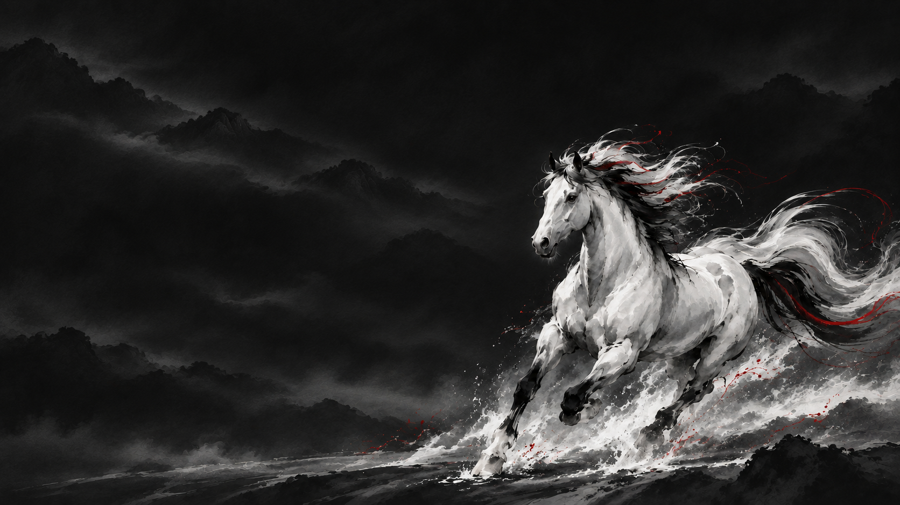
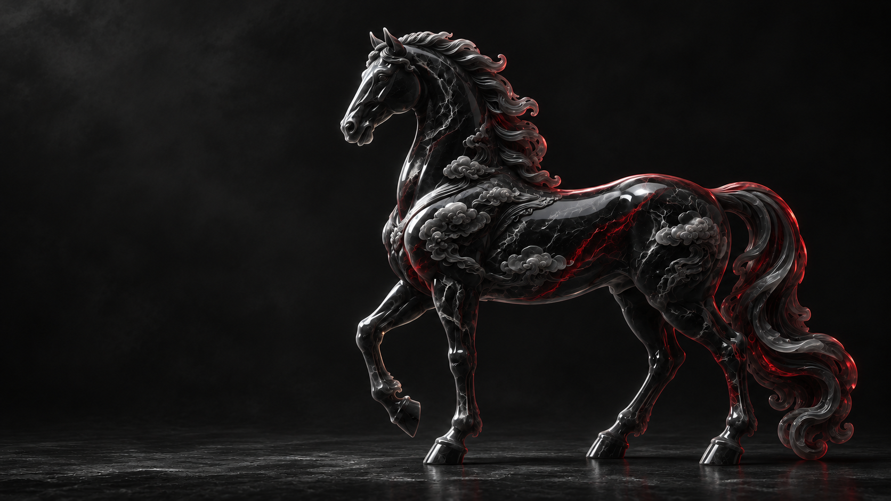
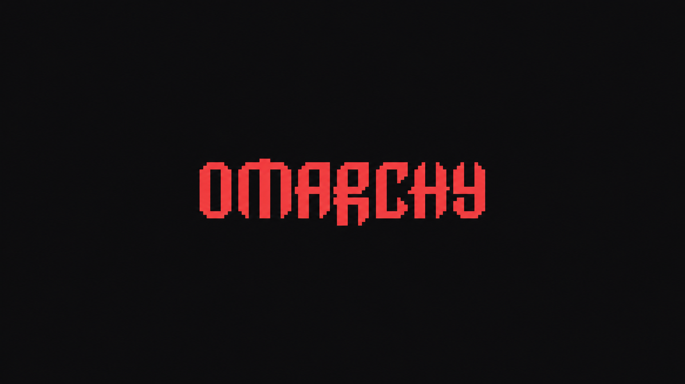

# Tsukuyomi

A black, red, and white theme for [Omarchy](https://omarchy.org/), inspired by Jade Horse. Charcoal surfaces, white text, crimson accents, and a mountain landscape beneath a red moon.


## Install and apply

Run this command on an Omarchy desktop:

```bash
omarchy theme install https://github.com/DanielCoffey1/omarchy-tsukuyomi-theme.git
```

Omarchy downloads the theme and applies it automatically. To switch back to it later:

```bash
omarchy theme set tsukuyomi
```

You can also select **Tsukuyomi** in Omarchy's theme picker.

## Palette

| Role | Color |
| --- | --- |
| Background | `#101012` |
| Dark background | `#0b0b0d` |
| Foreground | `#f2f0f0` |
| Bright foreground | `#ffffff` |
| Accent | `#ef4444` |
| Selection | `#542027` |

The theme includes `colors.toml`, red Yaru icons, four matching wallpapers, a theme-picker preview, and a crimson `unlock.png` companion asset. Omarchy generates supported application configurations from the palette. Red Yaru icons require the Yaru icon theme supplied by Omarchy. Lock-screen support for `unlock.png` depends on the Omarchy version.

## Wallpapers

The artwork follows Jade Horse's widescreen compositions with a black, red, and white palette. The generated adaptations preserve the overall framing and subjects, with some differences in fine detail.

| Wallpaper | Preview |
| --- | --- |
| Crimson mountain horses — original |  |
| Crimson ink horse |  |
| Carved obsidian horse |  |
| Omarchy wordmark |  |

Cycle wallpapers with `omarchy theme bg next` or use Omarchy's background picker.

## Credits

Inspired by Omarchy's Jade Horse theme. The wallpapers were adapted from its corresponding artwork using OpenAI's built-in image generation tool, with a black, white, and crimson palette. The original mountain wallpaper and theme palette are preserved. Generation prompts for the companion wallpapers are recorded in [ARTWORK.md](ARTWORK.md).
