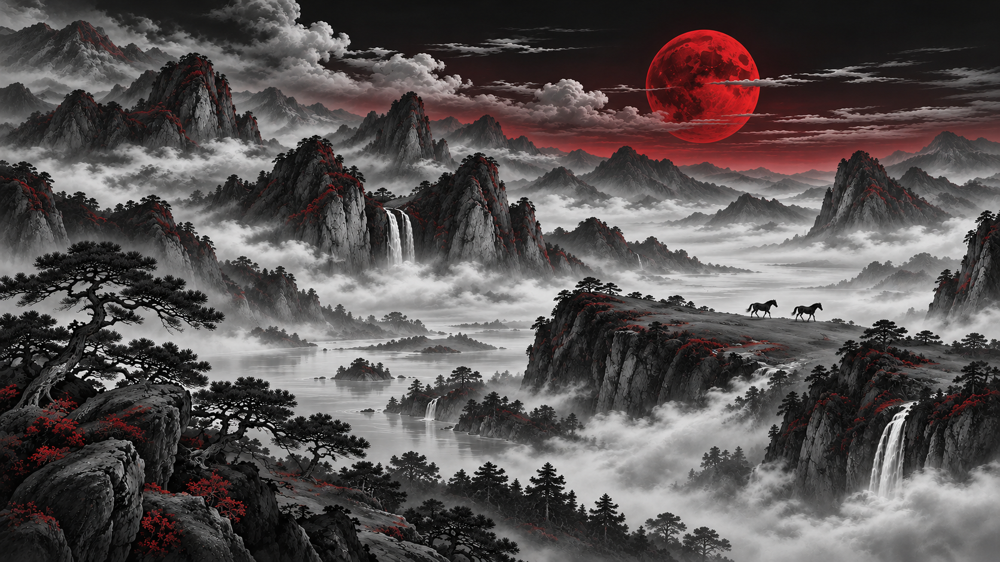

# Tsukuyomi

A black, red, and white theme for [Omarchy](https://omarchy.org/), inspired by Jade Horse. Charcoal surfaces, white text, crimson accents, and a mountain landscape beneath a red moon.



## Install and apply

Run this command on an Omarchy desktop:

```bash
omarchy theme install https://github.com/DanielCoffey1/omarchy-tsukuyomi-theme.git
```

Omarchy downloads the theme and applies it automatically. To switch back to it later:

```bash
omarchy theme set tsukuyomi
```

You can also select **Tsukuyomi** in Omarchy's theme picker.

## Palette

| Role | Color |
| --- | --- |
| Background | `#101012` |
| Dark background | `#0b0b0d` |
| Foreground | `#f2f0f0` |
| Bright foreground | `#ffffff` |
| Accent | `#ef4444` |
| Selection | `#542027` |

The theme includes `colors.toml`, red Yaru icons, and a matching wallpaper. Omarchy generates supported application configurations from the palette. Red Yaru icons require the Yaru icon theme supplied by Omarchy.

## Credits

Inspired by Omarchy's Jade Horse theme. The wallpaper was adapted from Jade Horse's mountain-and-horses wallpaper using OpenAI image generation, with a black, white, and crimson palette.
